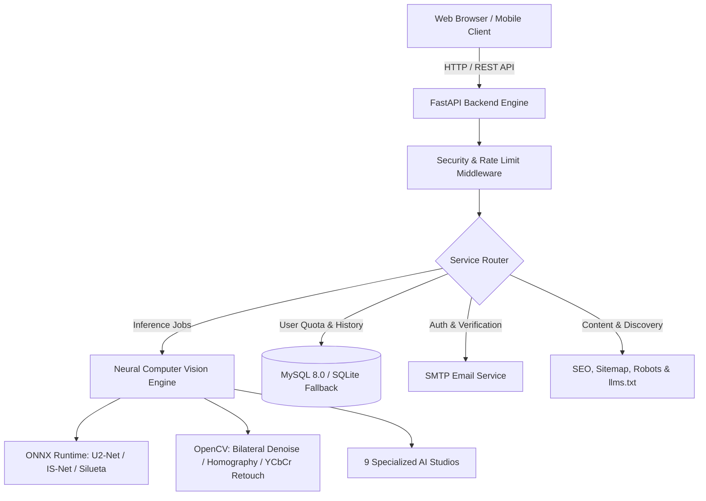

# PngLike — 9-in-1 AI Image Suite & Neural Background Remover
> **High-Performance Neural Computer Vision Platform & Content Studio**  
> *Powered by Div Sri*

[](https://python.org)
[](https://fastapi.tiangolo.com)
[](https://onnxruntime.ai)
[](https://tailwindcss.com)
[](https://pnglike.com)
[](LICENSE)

---

## 🌟 Overview

**PngLike** is a full-stack, production-grade AI image processing studio that delivers **9 neural computer vision tools** running in-memory with local ONNX models. Built with **FastAPI**, **ONNX Runtime**, **OpenCV**, and modern responsive **Tailwind CSS**, PngLike provides studio-quality photo editing, background removal, skin enhancement, super-resolution upscaling, and 3D relighting without sending private images to third-party cloud APIs.



---

## 🛠️ The 9-in-1 AI Image Tool Suite

PngLike organises 9 specialized neural tools into a seamless single-page tabbed studio. The free default tool is pinned first:

| # | Tool Name | Core Technology / Neural Model | Key Capabilities & Output |
| :-: | :--- | :--- | :--- |
| **1** | **Background Remover** *(Free Default)* | **U2-Net**, **IS-Net General**, **Silueta**, **U2-Net Human Seg**, **IS-Net Anime** | High-precision foreground extraction, alpha matting, custom background replacement (color, gradient, or custom backdrop), and transparent PNG export. |
| **2** | **Image Editor** | PIL, NumPy, Canvas 2D | Color grading, brightness, contrast, saturation, sharpness, rotation, aspect ratio crop presets (1:1, 4:5, 16:9), and artistic filters. |
| **3** | **Skin Enhancer** | YCbCr color space frequency separation & bilateral smoothing | Retouches blemishes and smooths skin tones while preserving natural pores and facial textures. |
| **4** | **Image Upscaler** | Lanczos4 super-resolution interpolation with bilateral denoising | 2x and 4x neural enlargement with edge sharpening and artifact reduction for print or high-res display. |
| **5** | **Image Extender** | Context-aware mirror feathering & seam blend outpainting | Expands canvas aspect ratios (e.g. 1:1 square to 16:9 widescreen) by hallucinating border surroundings. |
| **6** | **Variations** | Hue mapping, color grading & tone curves | Generates artistic stylistic variants: *Cyberpunk*, *Synthwave*, *Vintage Film*, *Anime*, and *Watercolor*. |
| **7** | **Cinematic Shot** | Subject mask depth-of-field blur & Hollywood LUT grading | Simulates f/1.4 optical bokeh behind the subject, applies teal-and-orange grading, and optional 2.39:1 anamorphic letterboxing. |
| **8** | **Relight** | Normal map estimation & directional 3D studio lighting | Casts virtual studio key, rim, and fill lights with customizable 3D angles, intensity, and color temperature. |
| **9** | **Change Camera** | 3D projective homography perspective transformation | Simulates optical focal length adjustments (e.g. wide-angle 24mm to telephoto 85mm portrait) and camera tilts. |

---

## ⏱️ Limitation & Rest Cooldown Architecture

PngLike enforces fair-use burst limits paired with real-time global timer synchronization and a non-intrusive glassmorphic toaster notification:

* **Guest (Unregistered) Users**: 
  * **3 daily operations** with a 10 MB maximum file upload limit.
* **Registered (Verified) Users**:
  * **10 images per active processing cycle**.
  * **30-Minute Rest Cooldown**: After processing 10 images, the user enters a 30-minute rest cooldown.
  * **Global UTC Synchronization**: The countdown timer synchronizes client clock drift with server UTC timestamps (`reset_timestamp`, `server_timestamp`), ticking down dynamically (`MM:SS`) in the navigation bar.
  * **Interactive Glassmorphic Toaster Notification**: Pops up with an amber glow when limits are hit, featuring live countdown, progress bar, and celebratory notification once the 30-minute rest completes.
  * **Automated HTTP 429 Guards**: Backend routes (`/api/remove`, `/api/tools/process`, `/api/batch-remove`) enforce cooldowns server-side.

---

## 🔒 Enterprise Security & Anti-Abuse Hardening

PngLike is engineered to resist abuse, unauthorized multi-accounting, and denial-of-service vectors:

* **Anti-Alias Enforcement**: Prevents plus-addressing tricks (e.g. `user+1@gmail.com`, `user+test@domain.com`) to stop users from bypassing quotas with single inboxes.
* **Disposable Email Blocker**: Rejects 40+ temporary email providers (e.g. `tempmail.com`, `10minutemail.com`, `guerrillamail.com`).
* **Decompression Bomb Dos Protection**: Strict image decompression ceiling (`Image.MAX_IMAGE_PIXELS = 50,000,000` and dimension max `5,000px`) prevents memory exhaustion attacks.
* **In-Memory Neural Processing**: Images are processed directly in RAM; uploaded files are not permanently stored or shared with external model trainers.
* **Password Hashing & JWT Auth**: Uses PBKDF2 with SHA-256 (600,000 iterations) with salted secrets and secure HTTP headers.
* **CSRF & Rate Limiting**: Token-based protection on state-changing endpoints with IP-based burst rate limiters.

---

## 📊 Comprehensive SEO & AI Discoverability (GEO)

PngLike scores **98.2/100 (A+)** in technical SEO, structured data validation, and AI search readiness:

* **Unified Canonicals**: 100% production-domain consistency across all routes (`https://pnglike.com/`).
* **Schema.org Structured Data (@graph)**:
  * `WebApplication`: Details softwareCategory, browser requirements, and all 9 tools.
  * `ItemList`: Machine-readable catalog of all working image tools.
  * `FAQPage`: Rich Google search snippet accordion markup on `/faq`.
  * `AboutPage` & `ContactPage`: Connects `Organization` and founder (`Div Sri`).
  * `BlogPosting`: Dynamic server-side JSON-LD injection for individual tutorials.
  * `BreadcrumbList`: Nested hierarchy navigation across all subpages.
* **Social Previews**: Complete OpenGraph and Twitter Card tags (`summary_large_image`, `@pnglike`, `@div_sri`) on all 11 routes.
* **AI Bot Crawler Directives**:
  * `/robots.txt`: Explicit crawl permits for `GPTBot`, `OAI-SearchBot`, `PerplexityBot`, and `ClaudeBot`.
  * `/llms.txt`: Comprehensive 4.5KB Markdown guide for LLM citation and agent tool invocation.
  * `/sitemap.xml`: Valid standard XML sitemap referencing all clean URL routes with priority weights.

---

## 🗂️ Project Directory Structure

```text
png/
├── models/                     # Cached neural weights (u2net.onnx, u2netp.onnx, silueta.onnx)
├── static/
│   ├── index.html              # Main 9-in-1 Tool Suite UI
│   ├── app.js                  # Frontend client, interactive viewport slider, canvas & timer
│   ├── blog.html               # Blog listing & tutorial reader shell
│   ├── blog.js                 # Blog dynamic routing & category filters
│   ├── dashboard.html          # User account dashboard & cloud gallery UI
│   ├── dashboard.js            # User profile, password management, and job history logic
│   ├── admin.html              # Admin CMS management portal UI
│   ├── admin.js                # System health, user management, and blog editor logic
│   ├── about.html              # About Us & vision page
│   ├── contact.html            # Contact support & inquiry portal
│   ├── faq.html                # Frequently Asked Questions with FAQPage schema
│   ├── privacy.html            # Privacy Policy (GDPR / CCPA)
│   ├── terms.html              # Terms of Service & commercial usage license
│   ├── cookies.html            # Cookie & storage policy
│   ├── style.css               # Styling, animations, and dark mode themes
│   ├── brand/                  # Logo SVGs, icons, and favicons
│   ├── samples/                # Built-in sample photos for instant testing
│   └── outputs/                # Processed images and downloadable archives
├── app.py                      # FastAPI server, REST API endpoints, and dynamic SEO renderer
├── database.py                 # SQLAlchemy ORM, MySQL connector & SQLite fallback manager
├── image_tools.py              # Pure Python & OpenCV implementation of the 9 AI image tools
├── email_service.py            # Gmail SMTP verification & notification engine
├── download_models.py          # Utility script to pre-fetch ONNX models
├── run_app.py                  # Server launcher
├── test_app.py                 # Automated test suite
├── verify_all_functionality.py # Comprehensive 64-point functional test suite
└── README.md                   # Project documentation
```

---

## 🚀 Installation & Local Setup

### 1. Prerequisites
* Python 3.10, 3.11, or 3.12
* MySQL 8.0+ *(Optional — automatically falls back to SQLite `rembg_studio_fallback.db` if MySQL is unavailable)*

### 2. Clone Repository & Setup Virtual Environment
```bash
git clone https://github.com/your-username/png.git
cd png

python3 -m venv .venv
source .venv/bin/activate  # On Windows: .venv\Scripts\activate
pip install -r requirements.txt
```

### 3. Pre-Download Neural Models
```bash
python download_models.py
```
*Downloads `u2net.onnx` and `u2netp.onnx` directly into the `models/` directory.*

### 4. Configure Environment Variables
Create or edit your `.env` file in the project root:
```ini
# Application Configuration
HOST=127.0.0.1
PORT=7860
SECRET_KEY=your_secure_random_jwt_secret_key_here

# Database Configuration (MySQL)
MYSQL_HOST=127.0.0.1
MYSQL_PORT=3306
MYSQL_USER=root
MYSQL_PASSWORD=your_mysql_password
MYSQL_DATABASE=rembg_studio

# SMTP Email Configuration (Gmail / Custom SMTP)
SMTP_HOST=smtp.gmail.com
SMTP_PORT=587
SMTP_USER=your_email@gmail.com
SMTP_PASS=your_gmail_app_password
SMTP_FROM_NAME="PngLike Studio"

# IndexNow Verification (Bing / Copilot SEO)
INDEXNOW_KEY=your_indexnow_api_key
```

### 5. Launch Application
```bash
python run_app.py
```
Open **`https://pnglike.com`** (or **`http://127.0.0.1:7860`** for local development) in your browser.

---

## 📡 REST API Reference

### Core AI Image Processing
* **`POST /api/remove`**: Single image background removal. Accepts `file`, `model`, `alpha_matting`, `bg_color`, and `output_format`.
* **`POST /api/batch-remove`**: Bulk removal of multiple files returning a structured `.zip` archive.
* **`POST /api/tools/process`**: Executes any of the 9 tools (`editor`, `skin_enhancer`, `upscaler`, `extender`, `variations`, `cinematic`, `relight`, `camera`).

### User Account & Quota Lifecycle
* **`GET /api/user/quota`**: Returns current quota limits, remaining images, cycle limit, rest minutes, and global UTC timestamp synchronization.
* **`POST /api/auth/register`**: Registers a new user with email alias rejection and password complexity validation.
* **`POST /api/auth/verify`**: Verifies 6-digit OTP code sent via SMTP.
* **`POST /api/auth/login`**: Authenticates user and returns JWT bearer token.
* **`GET /api/user/profile`**: Fetches user info, active tier, and personal gallery history.
* **`PUT /api/user/profile`**: Updates display name, phone, or biography.
* **`POST /api/user/change-password`**: Secure password change requiring current credentials.
* **`DELETE /api/user/account`**: Self-service account deletion with confirmation.

### Blog & Discovery Engine
* **`GET /api/blog`**: Lists published blog articles, tags, and reading estimates.
* **`GET /api/blog/{slug}`**: Fetches a single article and increments view counters.
* **`GET /robots.txt`**: Dynamic robots.txt with bot rules and sitemap reference.
* **`GET /sitemap.xml`**: XML sitemap of all public pages.
* **`GET /llms.txt`**: AI agent discovery manifest.

---

## 🧪 Testing & Verification

Run the full automated test suite to verify database operations, neural model caching, user auth security, and SEO integrity:

```bash
# Run unit & security test suite
python test_app.py

# Run complete 64-point end-to-end functionality verification
python verify_all_functionality.py
```

---

## 👨‍💻 Author & Attribution

* **Founder & Lead Architect**: **Div Sri**
* **Project**: **PngLike**
* **Official URL**: [https://pnglike.com](https://pnglike.com)
* **Copyright**: © 2026 PngLike Studio. All Rights Reserved.
